  

# UFC Manager

A Windows application for managing UFC event downloads and your local library, with a browser interface and a system tray app.

UFC Manager connects event metadata, indexer searches, SABnzbd downloads and verified library copying in one workflow. It is built on [autobrr](https://github.com/autobrr/autobrr), with native Go processing and the existing React interface.

## Features

- **Events:** upcoming and past events, editable metadata, aliases and component preferences.
- **Search and matching:** event searches, filename match testing, resolution preferences and excluded terms.
- **Downloads:** manual SABnzbd submissions, download tracking and recovery controls.
- **Automation:** match configured feed entries against eligible upcoming events using your settings and event overrides. Historical events remain manual-search-only.
- **Library:** scan existing files, review event coverage and browse grouped media.
- **Processing:** verified copies into your library, with review, skip or keep-both handling for conflicts. Existing library files are never replaced.
- **Notifications:** use configured notification destinations, including Discord.
- **Windows integration:** tray controls, optional login startup, per-user MSI and portable ZIP packaging.
- **In-app updates:** a launcher-based updater verifies signed release metadata before installing and relaunching. Automatic installation is optional.

Automatic downloads, processing and download removal require explicit configuration. Optional source cleanup applies only to verified, fully imported UFC-owned SABnzbd downloads outside library roots.

## Availability

**Windows x64 is the supported application target.** Download the MSI from [Releases](https://github.com/VulcanGH/UFCM/releases). Existing launcher installations can use **Settings → Check for Updates**.

SQLite is the default database and supports in-app updates. PostgreSQL remains available for operator-managed installations; in-app update installation is disabled for PostgreSQL.

The application is under active development. Keep backups before installing updates.

## Getting Started

You will need configured indexer/feed connections, SABnzbd for downloads, and your chosen library folders. Configure these through the web interface, then select the components and resolutions you want in Manage settings.

Launcher packages use `ufc-manager-launcher.exe`. The tray menu provides **Open Web UI**, **Open Config Folder**, **Start on Login** and **Quit**. The default web address is `http://127.0.0.1:7475`.

Configuration, database and logs are stored separately from installed application files. See the [Windows package guide](distrib/windows/UFC-README.txt) before installing or upgrading, especially if you already use a development preview.

## Documentation

- [Windows installation and updates](distrib/windows/UFC-README.txt)
- [Building from source](BUILDING.md)
- [Release contents](PACKAGING.md)

## Development and Contributions

The backend uses Go; the frontend uses React, TypeScript and pnpm. Follow the [build instructions](BUILDING.md) and [contribution guide](CONTRIBUTING.md). UFC Manager pull requests target `main`.

Report UFC Manager issues in [this repository](https://github.com/VulcanGH/UFCM/issues). Do not include API keys, notification webhooks or private configuration in reports.

## Credits and Licence

UFC Manager is an independent fork of [autobrr](https://github.com/autobrr/autobrr). Thanks to the autobrr contributors for the foundation. The [original upstream README](README.autobrr.md), copyright notices and [GPL licence](LICENSE) are retained. The local tray-library correction retains its [MIT licence](third_party/systray/LICENSE) and [patch record](third_party/systray/PATCHES.md).

This project is not affiliated with or endorsed by UFC or autobrr. Public branding, asset provenance and distribution review remain outstanding.
